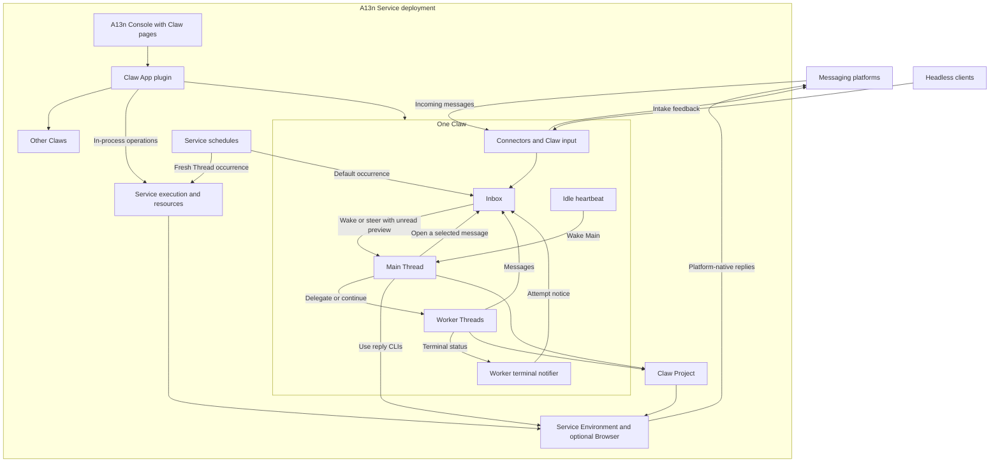
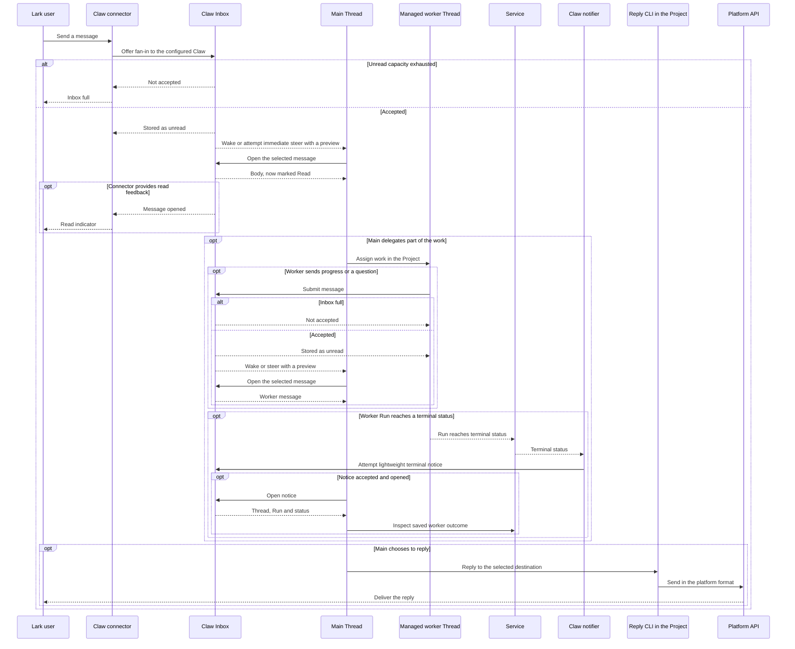

# Product and Architecture Overview

## Product Position

Claw brings interactive agent work to messaging platforms. Users start work, add context, work with persistent workers, and receive results and files through IM. A13n Console and headless clients are operator surfaces for inspecting progress, responding to native questions and approvals, and stopping a selected operation.

One Claw App installation manages multiple Claws in the same Service deployment. Each Claw has its own connector configuration, one Project, and one Main Thread that coordinates its worker Threads. A connector is configured for a Claw; Claw does not select an assistant from message content. All of a Claw's connectors share its Main Thread, Agent, and trust and authority domain. Use separate Claws and resources when isolation is required. Each Claw keeps its own Inbox and heartbeat. Selecting the same Service agent does not join two Claws' conversations.

## Architecture

Service owns Agents, Threads, Entries, Runs, schedules and their occurrences, models and model-provider configuration, along with resource authorization and lifecycles. Main and worker are roles of native Service Threads, not separate Thread or Agent types. Claw owns its Project, connectors, Inbox, Thread associations, and heartbeat condition. Its AppDatabase stores those business facts and references to the native resources; it does not mirror their definitions or execution state.

## Project

Each Claw's [Project](04-project.md) gives Main and its workers a shared persistent working context. The [operator workflows](05-operator-workflows.md) cover setup, inspection, and recovery in A13n Console and headless operation.

## End-to-End Flow

The connector addresses a specific Claw. The [Inbox](01-inbox.md) owns acceptance, unread previews, and read history. Default-mode scheduled occurrences also enter that Inbox; Service retains the schedule and occurrence lifecycle. The [Main Thread](02-main-thread.md) owns the choice of what to read, handle, or delegate. Service executes Main and its worker Threads in their Project context. Acceptance, opening an item, completing its work, and sending a reply are separate events.

## Integration and Distribution

Claw uses A13n's App scaffold and contributes its frontend directly to A13n Console. It uses Service's supported in-process operations rather than maintaining a separate execution runtime. Shared capabilities belong in their A13n subsystem; Claw owns the messaging and operator workflows that use them.

Claw and Service share a major/minor release line with independent patch numbers. Claw develops and validates against one exact Service version in that line. Its release image derives from that published Service image and includes the Claw App and Console contribution.
