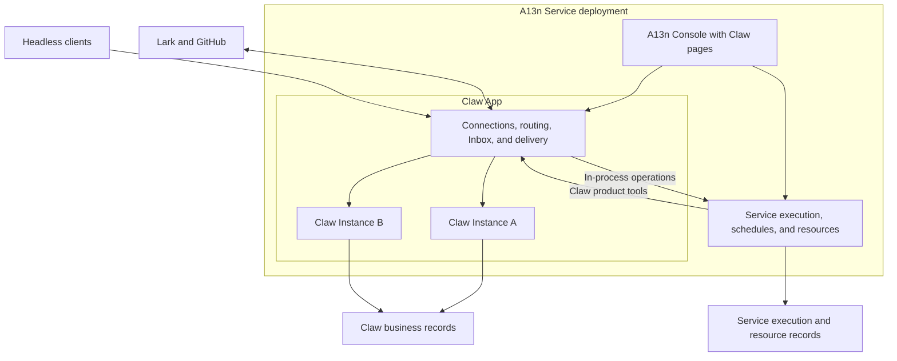

# Product and Architecture Overview

## Product Position

Claw brings interactive agent work to messaging platforms. Users start work, add context, inspect progress, answer questions and approvals, stop a selected operation, work with persistent workers, and receive results and files. IM is the conversation surface. A13n Console and headless clients are operator surfaces.

One Claw App installation serves multiple Claw Instances in the same Service deployment. An Instance selects its own agents, routing mode, connections, and working context. Main, when used, is the canonical Thread of **one Instance**, not the only agent or conversation in the deployment. Instances can use different agents or select the same Service agent without sharing a conversation. See [domain model](01-domain-model.md).

## Architecture

Claw resolves the Instance and applies external policy. Service owns workspace and resource authorization, execution (including collaboration and continuation), schedule timing, and resource lifecycles. Claw stores external records and maps them to native references in its own tables. The native records are the execution authority, not the source of Claw's routing or delivery policy.

## Work Path

1. A qualified external event selects a Claw Instance and Channel. Claw validates the sender and retains the accepted work before acknowledging it.
2. Claw selects Main, an existing Channel Thread, or a fresh task Thread according to the Instance's routing mode. It requests native admission or an exact control operation. Service owns acceptance and execution.
3. The user interacts with the selected work without opening a browser. The App links business progress to native observations; One Thread mode uses explicit Inbox settlement and explicit publication.
4. A reply or file is a separate external delivery with a qualified destination. Uncertain delivery does not rerun the agent or trigger an automatic resend.

The [operator pages](06-api-console-and-access.md) cover Overview, Runs, Models & Accounts, and Schedules. [Automation](08-automation.md) uses the same Service runtime in independent conversations. The [App integration boundary](11-host-integration.md) applies to both interactive and scheduled work. Claw does not provide a second runtime, separate Console, or general workflow engine.
