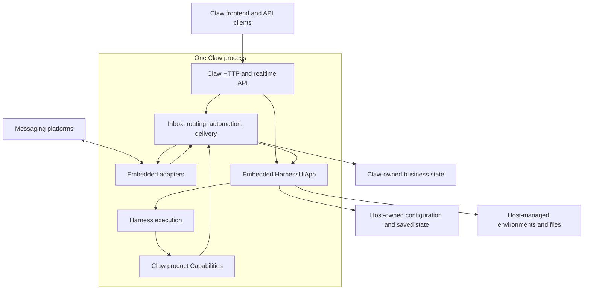

# Product and Architecture Overview

## Product Position

Claw brings Harness UI's interactive Agent experience to messaging platforms. Users send work, add context during execution, answer questions and approvals, stop a selected operation, collaborate with workers, and receive results and files in IM. Claw adapts those interactions to each platform while the embedded Host keeps its native execution and collaboration semantics.

IM is the primary conversation surface; CLI/API provide setup, inspection, and operations. The runtime frontend is a Hello World placeholder in this replacement scope. Neither a full Console nor a workflow engine is required for the messaging path.

Claw deploys as one process with one embedded `HarnessUiApp`. Direct Python calls connect product services to the App. The supported dependency is the `a13n-harness-ui` package; Harness remains its execution foundation. There is no internal HTTP hop or separately managed Harness UI service.

## Architecture

The diagram describes responsibility, not a required class hierarchy. Product tools invoke bounded Claw operations with Host-bound caller context. They do not start a nested Host, access private execution objects, or synchronously wait for another Agent to complete.

## Ownership

| Concern                                                              | Owner                        | Claw's role                                                   |
| -------------------------------------------------------------------- | ---------------------------- | ------------------------------------------------------------- |
| Model, Agent, MCP, Skill, extension, and Project resources           | Harness UI                   | Present and edit through supported Host operations            |
| Thread identity, composition, execution, decisions, and continuation | Harness UI                   | Select destinations, request operations, and present results  |
| Coordinator roles, worker ownership, and subagents                   | Harness UI                   | Select Main and integrate product attention                   |
| Environment selection, preparation, state, and lifecycle             | Harness UI and its providers | Offer product defaults and authorized controls                |
| File-memory scopes, projection, and organization                     | Harness UI and Harness       | Expose the supported settings and views                       |
| Channel identity, sender filtering, and routing                      | Claw                         | Normalize external context and apply product policy           |
| Inbox dispositions and automation occurrences                        | Claw                         | Retain business intent and decide when to request execution   |
| External message delivery                                            | Claw and platform adapters   | Retain explicit destinations and reconcile transport outcomes |
| Product API, frontend, and external access policy                    | Claw                         | Authenticate clients and expose only intended operations      |

Claw stores references to Host Threads and observable operations. It does not mirror checkpoints, capture a second execution composition, implement a second worker graph, or manage a parallel environment pool. [Host integration](11-host-integration.md) owns the required embedding contract.

## Product Modes

[One Thread mode](10-one-thread-mode.md) is the default for new Instances: eligible external messages enter a durable Inbox for one canonical Main Host Thread. Main uses Host-native workers and explicitly publishes external messages through Claw. Per-Channel mode reuses one conversation Thread per Channel; per-trigger mode creates a fresh task Thread for each eligible event. Both are explicit alternatives. Mentions-only is an independent admission filter for all three modes.

Host Projects and configuration selections are retained as Host concepts. In per-Channel and per-trigger modes, each Channel maps to a stable Host Project so its Threads share Channel memory plus Global memory. One Thread mode uses Main's shared Project and Global memory across all participating Channels, without Channel memory partitions or a Host memory extension. [Memory](09-memory.md) owns the mapping and transition rules; Claw adds no separate memory store.

## End-to-End Work Path

1. An adapter authenticates an external event; Claw checks sender, group filter, and qualified event identity.
2. Claw retains the eligible message and routing context before acknowledging business acceptance.
3. Product dispatch checks actionable work, current policy, and Host availability, then records an attempt before calling the Host. This happens without a separate human Inbox approval step.
4. Claw selects public submission or exact-operation steering; the Host owns admission, composition, decisions, execution, and checkpoint publication. Claw presents supported observations and exact controls back through the adapter.
5. In One Thread mode, Main reads and explicitly settles Inbox work through Claw Capabilities. Host completion alone does not settle an item.
6. An authorized send creates a separate delivery record. Adapter failure is reconciled from that record, without rerunning the Agent.
7. After restart, Claw rediscovers business backlog and checks Host state. Ambiguously affected items or effects remain blocked rather than being replayed; unrelated native interaction remains available.

Explicitly targeted human conversation uses the Host interaction model without a durable Claw prompt queue. Ordinary IM messages use the selected mode's retained ingress. Native worker messages and coordinator follow-up coexist with Inbox drain under the [execution contract](03-execution-lifecycle.md). Automation retains occurrences as business intent and uses the same product-to-Host boundary. [Bridges](07-bridges-and-clients.md#interactive-im-behavior) owns the IM action mapping and feedback.

## Lifetime

Claw owns process startup and shutdown. It opens its business store and the embedded Host through each owner's lifecycle, validates the selected product bindings, and enables dispatch only after the required capabilities are ready. A failed Host startup prevents new execution; it does not erase retained Inbox or deliveries.

Shutdown stops new ingress and automated dispatch, settles product mutations and outbound attempts, then drains or closes Host execution through its supported lifecycle before closing stores. Product services used by active tools remain available during that drain. Browser disconnection is unrelated to shutdown. Only one Claw process owns an Instance; another interactive Host process must not concurrently manage the same embedded store.

## Non-Goals

Claw does not implement distributed scheduling, tenant isolation, a general Host SDK framework, interchangeable local/HTTP backends, a separate execution engine, or recovery of arbitrary operating-system processes. It does not require changing Harness UI into a durable workflow service. The [source boundary](repository-model.md) distinguishes this target from current implementation and publication.
