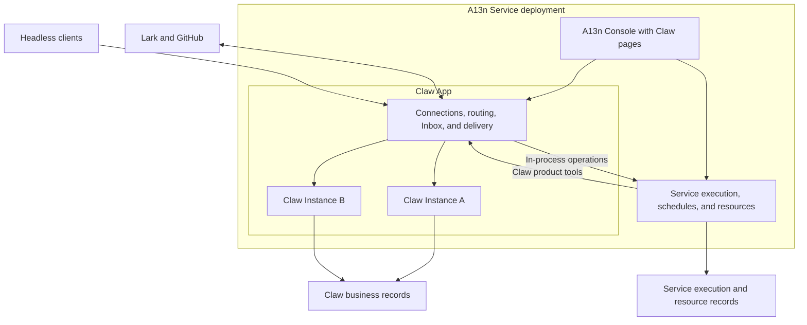

# Product and Architecture Overview

## Product Position

Claw brings interactive agent work to messaging platforms. Users start work, add context, inspect progress, answer questions and approvals, stop a selected operation, work with persistent workers, and receive results and files. IM is the conversation surface. A13n Console and headless clients are operator surfaces.

One Claw App installation serves multiple Claw Instances in the same Service deployment. An Instance selects its own agents, routing mode, connections, and working context. Instances can use different agents or select the same Service agent without sharing conversations or external authority.

## Architecture

Claw resolves the Instance and applies external policy. Service owns workspace and resource authorization, execution (including collaboration and continuation), schedule timing, and resource lifecycles. Claw stores external records and maps them to native references in its own tables. The native records are the execution authority, not the source of Claw's routing or delivery policy.

## Integration and Distribution

Claw uses A13n's App scaffold and contributes its frontend directly to A13n Console. It uses Service's supported in-process operations rather than maintaining a separate execution runtime. Shared capabilities belong in their A13n subsystem; Claw owns the messaging and operator workflows that use them.

Claw and Service share a major/minor release line with independent patch numbers. Claw develops and validates against one exact Service version in that line. Its release image derives from that published Service image and includes the Claw App and Console contribution.
