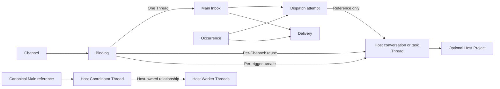

# Domain Model and Ownership

## Design Position

Claw owns assistant-product concepts and refers to Host concepts by their existing identities. A reference provides correlation, not authority. These are conceptual models, not prescribed tables or wire schemas.

## Host Concepts Used Directly

| Concept                | Meaning in Claw                                                                                      |
| ---------------------- | ---------------------------------------------------------------------------------------------------- |
| Host                   | The one embedded Harness UI App serving this Instance                                                |
| Project                | A Host-owned working context, creation configuration, and memory scope referenced by product routing |
| Agent and Model        | Host resource selections; Claw defines no parallel Profile catalog                                   |
| Thread                 | A Host conversation and continuation identity; no separate Claw Thread ID                            |
| Run or operation       | Host-owned execution and control; a process-local receipt is not a durable work ticket               |
| Checkpoint             | Host-owned complete continuation, accessed only through supported Host operations                    |
| Pending decision       | A Host-owned request with its exact response and continuation rules                                  |
| Worker                 | A Host root Thread owned by a Host Coordinator, distinct from a delegated child                      |
| Environment and memory | Host-selected execution resources and knowledge scopes                                               |

Host lifecycle names and state transitions are not redefined here. The frontend can simplify presentation while preserving the difference between saved facts, current observations, and unknown state.

## Claw Concepts

| Concept               | Durable meaning and owner                                                                                 |
| --------------------- | --------------------------------------------------------------------------------------------------------- |
| Instance              | One Claw deployment, its selected embedded Host context, and product settings                             |
| Connection            | One configured messaging account or installation and its adapter policy                                   |
| Channel               | An external conversation qualified by platform and connection                                             |
| Binding               | Product routing and participant/destination policy referencing Host identities                            |
| Inbox item            | Retained external content or product attention requiring an explicit processing disposition               |
| Dispatch attempt      | A record that Claw may have called the Host for particular business work; not a Run or an execution claim |
| Delivery              | Explicit retained content, origin, destination, and transport outcome                                     |
| Automation definition | Authorized intent to request work under stated timing and scope rules                                     |
| Occurrence            | One identified firing or workflow step opportunity, independent of Host execution                         |

The [Inbox contract](10-one-thread-mode.md#durable-inbox) owns processing dispositions. [Recovery](04-persistence-and-recovery.md#dispatch-evidence) owns dispatch evidence. [Delivery](07-bridges-and-clients.md#egress-and-reconciliation) owns send outcomes. These are independent facts, not one generic task state machine.

## Relationships

Main is a Claw-selected Host Coordinator Thread, not a new conversation type. Claw persists its canonical reference; the Host owns its role and worker relationships. Claw discovers workers through Host queries instead of copying their ownership graph. Per-Channel and per-trigger bindings map each qualified Channel to a stable Host Project; conversation and task Threads select that Project. One Thread uses Main's shared Project across Channels. [Memory](09-memory.md) owns scope selection. Non-Channel Console and automation Threads may select or omit Projects under Host rules. Project and Channel identities remain distinct; Claw retains their association without copying Host resource definitions.

A Channel can be rebound for future events without rewriting retained origins or destinations. Channels sharing Main explicitly share Agent context; per-Channel and per-trigger modes keep distinct Channel Project associations. Console-created Threads and automation can exist without a Channel. A single Host operation can receive attention for several business items; an Inbox item can require several separate operations before settlement.

## Identity and Completion Boundaries

An external event identity is scoped to its platform and connection. Identical redelivery returns the prior product disposition; conflicting reuse fails. Dispatch attempts and deliveries keep their own identities. Host receipt identities remain subject to Host lifetime and query guarantees even when copied into a product record.

Business acceptance means Claw retained the item or occurrence. Host admission means the Host accepted a current operation. Saved execution means the Host published the corresponding facts. Business settlement means an authorized actor recorded the item's disposition. Delivery confirmation means the external transport supplied the required evidence. None implies the next.

Creation, initial prompt submission, and worker ownership follow the Host's separate completion boundaries. A created Thread remains identifiable when subsequent admission fails. Claw must not promise atomic create-and-run or retry creation merely because a receipt was lost.

## Authority

Claw records whether work originated from a human, an external event, automation, or a product notification. The Host binds the actual executing Thread and configuration; model text cannot choose that identity. Source attribution does not grant permission to read other Inbox items, answer decisions, change Host configuration, or publish externally.

Claw's participant and destination policy complements Host execution controls. Separate Threads do not imply isolated memory, working files, or host-account execution. [Access](06-api-console-and-access.md) owns those disclosure and permission boundaries.

## Invariants

1. Every execution reference identifies Host-owned state; Claw has no competing Thread, Run, or checkpoint authority.
2. Product intent, dispatch evidence, business settlement, and external delivery remain independently inspectable.
3. Worker relationships and Project membership are queried from the Host, never inferred from titles or copied history.
4. A lost process-local receipt cannot be converted into proof that execution never happened.
