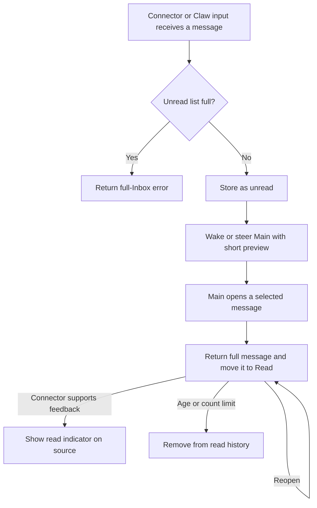

# Inbox

## Unread and Read

Each Claw has its own Inbox for all incoming user messages. Built-in connectors and the Claw input interface use the same Inbox. Like a mailbox, the Inbox shows an unread list with the source, sender, and a short preview. An accepted message is unread. A notice or list view does not mark it read or put its full contents into Main's conversation.

Main opens a selected message with `pop`. It receives the full message, and the message moves from Unread to Read. Main chooses the order and what to do with each message. Read means the message was opened, not that any work mentioned in it was accepted, completed, delegated, or replied to.

Main can reopen a read message while it is retained. Reopening a read message does not make it unread or generate another unread notice. Only unread messages keep the Inbox prompting loop active; read history does not prevent Main from going idle.

A connector can reflect the first open on the source platform, for example with a Lark reaction. The reaction means Read, not that the work finished. A failed reaction does not make the message unread.

## Capacity and Retention

Each Claw can configure its unread and read limits independently. The unread limit defaults to 500 messages. When the unread list is at or above its configured limit, Claw rejects new messages without evicting an unread message. The connector tells the sender that the Inbox is full and the new message was not accepted. Rejected messages do not produce unread notices. Opening an unread message frees a slot.

The read limit defaults to 3,000 messages. Claw keeps read messages for up to seven days after they were first opened. When the configured read limit is exceeded, Claw removes the earliest-read messages first. Reopening does not extend retention. Cleanup does not alter any associated Thread, worker task, or delivery.

## Message Flow

