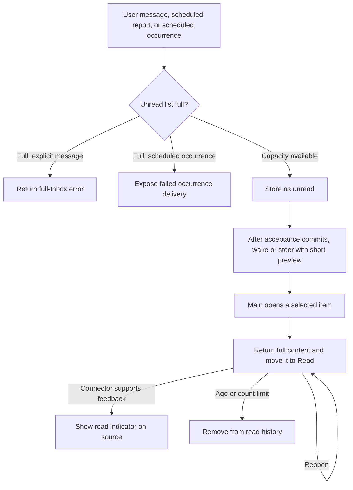

# Inbox

## Unread and Read

Each Claw has its own Inbox for incoming user messages, fresh scheduled-Thread reports, and default-mode scheduled occurrences. Built-in connectors and the Claw input interface use the same Inbox. Native child messages and results use the Service Thread Inbox instead. Each accepted item retains its content and available source context, including the sender or scheduled occurrence that identifies its origin. Like a mailbox, the Inbox shows an unread list with the source and a short preview. An accepted item is unread. A notice or list view does not mark it read or put its full contents into Main's conversation. For a scheduled item, the preview describes the occurrence without exposing its trigger-time prompt.

Main opens a selected item with `pop`. It receives the full content, and the item moves from Unread to Read. Main chooses the order and what to do with each item. Read means the item was opened, not that any work mentioned in it was accepted, completed, delegated, or replied to.

Main can inspect retained read history and reopen a read item while it is retained. Reopening returns its retained content and source context; it does not make the item unread, repeat its acceptance, or generate another unread notice. Only unread items keep the Inbox prompting loop active; read history does not prevent Main from going idle.

A connector can reflect the first open on the source platform, for example with a Lark reaction. The reaction means Read, not that the work finished. A failed reaction does not make the message unread. [GitHub-origin acceptance feedback](03-connectors-and-replies.md#input-boundary) is a separate event.

## Capacity and Retention

Each Claw can configure its unread and read limits independently. The unread limit defaults to 500 items. At or above that limit, Claw does not evict an accepted unread item. Opening an unread item frees a slot; rejected or dropped items do not produce unread notices.

| Offered item                      | Full-Inbox behavior                                                                           |
| --------------------------------- | --------------------------------------------------------------------------------------------- |
| User message or scheduled report  | Reject and return an Inbox-full result to the sender.                                         |
| Default-mode scheduled occurrence | Reject admission and expose the failed delivery as an occurrence outcome, not completed work. |

There is no global priority queue. Main prefers user input when choosing work, without strict ordering or blocking scheduled reports or occurrences.

The read limit defaults to 3,000 items. Claw keeps read items for up to seven days after they were first opened. When the configured read limit is exceeded, Claw removes the earliest-read items first. Reopening does not extend retention. Cleanup removes that Inbox history without retaining a separate copy of the item for deduplication or replies. It does not remove content already entered into a Thread's saved context; native context management remains under Service. Claw retains [schedule occurrence identity and acceptance](02-main-thread.md#scheduled-work) as schedule facts, not as a copy of the removed item.

## Message Flow

