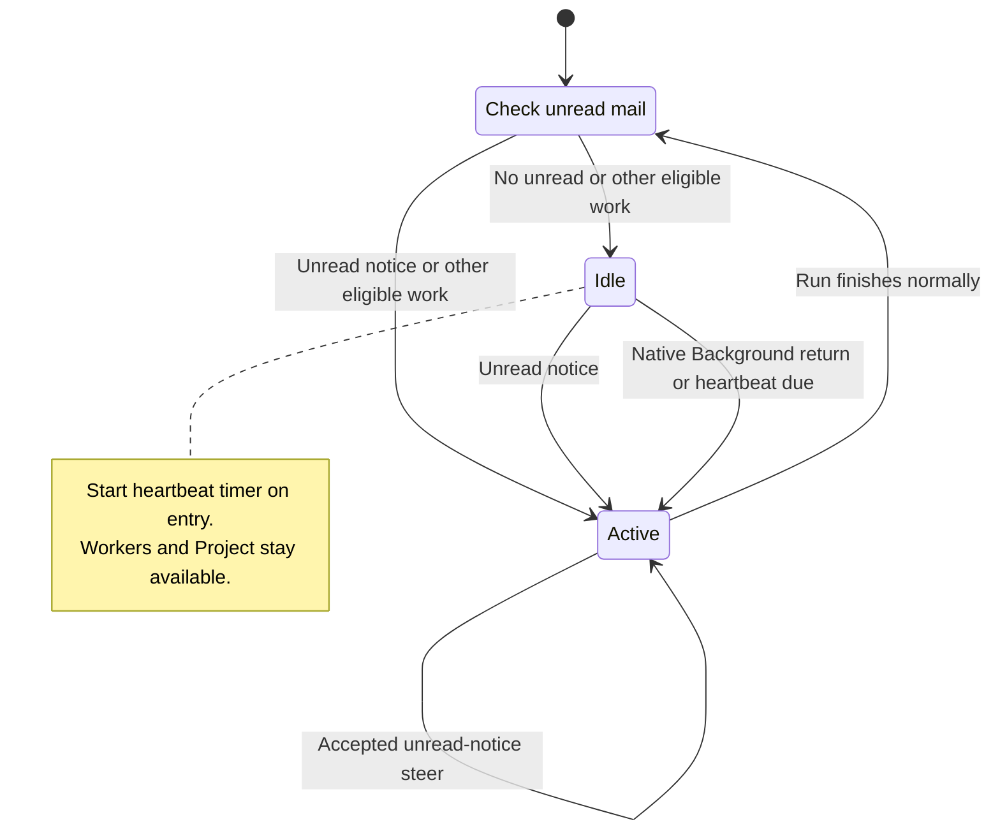

# Main Thread

## Input and Coordination

Each Claw has one persistent Main Thread. Main reads incoming messages, replies, coordinates work, and handles short tasks. It delegates long-running work to its managed worker Threads. Main and its workers use the Claw's [Project](04-project.md); the Main Thread keeps its identity across Runs and wakeups.

All user messages submitted to Claw, including from its input interface, first enter the [Inbox](01-inbox.md). After acceptance, Claw attempts an immediate steer of the active Main Run with a notice and short preview, or wakes idle Main. The steer is a best-effort notification, not a second submission of the message. If the notice cannot be delivered immediately, the message remains unread. Main chooses what to open and in what order.

Committed Run seal notifications are best-effort hints. A normal Main completion can immediately wake the same Thread for unread work once it is still the latest Run and no native Inbox entry takes priority. A wake that made no Inbox progress does not immediately repeat on its own completion; the maintenance sweep still retries unread work. A seal notification cannot reopen a failed or cancelled Main or resolve a native wait. The sweep reconciles missed hints and remains responsible for heartbeat, schedules, and retention.

Main handles user-facing communication; ordinary user messages do not go directly to workers. A heartbeat wakes the same Main after the configured idle interval. Main and Workers do not wait for interactive approvals, native user questions, or client tool responses. A decision-dependent operation is denied; an unexpected suspension fails the Run rather than being treated as completion.

Claw supplies Main and its workers with [capabilities and instructions](04-project.md#agent-composition) suited to their available resources. Main uses background tools for operations that need to continue without blocking input handling; workers remain the owners of delegated long-running work.

## Managed Workers

Main delegates to Service's native asynchronous subagents. Named Workers select published Agent revisions; dynamic Workers inherit a subset of the Main Run's capabilities and use a configured model or Main's own model, which Service always permits. Dynamic Workers and named Workers with shared Environment policy inherit the parent Run's captured Environment mounts; named Workers with dedicated or none policy follow their configured policy. Native Workers do not inherit the parent Browser by default. Service owns child execution, continuation, messages, and terminal results.

A native child's messages and terminal results enter the parent Service Thread Inbox, not the Claw Inbox. They are not duplicated as Claw worker messages or terminal notices. Main can inspect child Threads and saved Runs through native controls. Historical Claw Worker records and previously accepted Inbox entries remain available; the former custom assignment, steering, and worker terminal-notice paths do not create new work.

Workers do not have human-approval, native user-question, or deferred decision tool paths. Claw does not automatically approve operations: Service grants and execution policy remain authoritative. If work needs a human decision, a Worker reports the need to Main without entering an interactive wait. Native Background completion likewise returns to its owning Thread without going through the Claw Inbox.

## Scheduled Work

Main chooses an execution mode when it creates a scheduled task. The default delivers each scheduled occurrence to the Claw Inbox as an unread item, not as the scheduled prompt in Main's native input. An unread notice can wake or steer Main with a short preview of the occurrence; the trigger-time prompt enters Main's context only when Main opens the item. A scheduled item is not a user message. Use this mode for ordinary tasks and work that needs continuity with Main's context.

Claw owns both modes of schedule definitions, durable cron and one-time rules, lateness, coalescing, overlap decisions, and occurrence history in its AppDatabase. A Service App OrganizationSweep supplies bounded execution cadence; it does not own the schedule state. Missed cron matches are coalesced subject to lateness, and a firing overlapping an unfinished occurrence is skipped. Main may update or delete these schedules and trigger one immediately. A manual trigger does not move the future rule and is available for a paused schedule; it follows the same overlap rules and, for Main, Inbox capacity rules. Replaying the same tool call returns its original occurrence rather than admitting another item. Deletion stops future occurrences but retains history.

Claw records the occurrence identity and Inbox acceptance together. Repeated sweeps or restarts do not admit an occurrence more than once, even after the Inbox item leaves retained history. After that commit, Claw attempts the ordinary wake or steer with an occurrence preview, without exposing the prompt. This path uses no Service Schedule, placeholder Run, or interception of a native scheduled Run. An Inbox-full rejection is visible as an occurrence delivery outcome; admission is not execution or completion.

An accepted occurrence remains outstanding while its Inbox item is unread or Main is processing it. Opening the item marks it Read but does not itself finish the occurrence. Main's processing outcome ends that occurrence; it does not wait for the entire downstream chain of worker work that Main may delegate. A processing failure or cancellation is not successful completion, and an uncertain outcome is not assumed successful. Pending native decisions are not answered or bypassed by schedule delivery.

For self-contained work, Main can instead select a fresh native Thread in the same Project for each firing. Claw creates the Thread at firing time using the current Project resource selections and records the exact Session, Thread, and Run on the occurrence. The scheduled Thread reports its outcome to Main for user-facing communication through the scheduled reporting path, not a native child-result notification. Fresh Threads do not receive connector Egress credentials; Main uses its current authorized connector credentials for user-facing communication. The occurrence remains outstanding until its Run reaches a terminal outcome. Run-seal notifications settle it promptly when delivered; the sweep reconciles missed notifications.

A fresh schedule requires a Project Environment. At firing time, unavailable required resources produce an unavailable occurrence instead of a Thread. Native admission failure rolls back the whole attempt; a separate transaction advances the clock and records the error only while the same due slot, definition, and Project selections remain current. Late and overlap decisions take precedence over admission refusal at the original decision time. Switching a schedule from fresh to Main waits until its outstanding fresh occurrence settles. Reusing a creation request key with the same effective definition returns the original schedule; a changed definition conflicts. A Main Run may create one only while its lease and captured authority remain valid, and the current account authority must not exceed that capture. This pre-release schema requires a clean installation.

Claw's instructions guide Main to create each task and write its trigger-time prompt:

- Choose the execution mode for the task, defaulting to Main's Thread and selecting a fresh Thread for self-contained transactional work.
- State the objective and context needed to execute the task, including the originating Thread and exact relevant source identifiers.
- Identify the execution target: Main's Thread for the default mode, or the new Thread created for that firing in fresh-Thread mode. A fresh Thread does not need a preallocated ID in the prompt.
- Specify how the outcome reaches Main and, when appropriate, the intended user-facing destination, including the exact relevant Thread or platform endpoint IDs. Do not assume an automatic broadcast or a particular result-routing API.

## Activity and Idleness

Claw prompts Main again if a Run finishes and unread mail remains. Once Main can accept work, an unread notice can continue the same Thread. A failed or cancelled Run is not treated as normal completion or implicitly restarted by a heartbeat.

When Main has no active work or outstanding decision, no unread mail, and no competing eligible work such as a native Background return, it becomes idle and the heartbeat interval starts. New eligible work can bring Main back before that interval ends. If Main finishes that work and goes idle again, the interval starts again. Heartbeats occur only during true idleness and do not catch up missed intervals. An independently running worker does not by itself keep Main active; idleness does not stop that worker or the Project resources.

The diagram shows the normal work loop; after a Run finishes, all eligible work is considered before idleness. Native failures, cancellation, and uncertain admission stay visible as such; they are not a normal completion or a reason to repeat an input whose outcome is unknown.

## Heartbeat Follow-Up

On a heartbeat, Main checks unfinished work, reads relevant worker status or saved outcomes as needed, and takes the next useful step within existing authority. A heartbeat does not authorize new work. Main communicates meaningful results or blockers through the normal reply path, not routine check-ins.

For each root Main Run that may perform quiet heartbeat follow-up, Claw selects a per-Run output contract with both ordinary text and the built-in server-side `finish_silently` terminal output tool as alternatives. This selection applies to that Run, not to unrelated Runs or the Agent's saved output configuration. It uses the built-in handler; it does not require a Claw handler or a client receipt.

When the heartbeat needs no further action or user-facing reply, Main calls `finish_silently` with no arguments or accompanying text. The Run completes successfully with a persisted JSON `null` output, without another model turn solely to finish. The Run and its execution history remain inspectable. A `null` output alone does not establish success: inspect the Run status. An ordinary function tool that returns nothing, or an empty model response, does not signal quiet completion.

Neither terminal output nor ordinary text implicitly publishes to a platform, and quiet completion does not retract text already streamed. Main uses the normal explicit [CLI reply path](03-connectors-and-replies.md#cli-first-replies) when a reply is needed. Quiet completion does not override pending decisions, discard Inbox items, or suppress a reply still owed to a user whose input arrived during the Run. Unread work remains eligible for the normal Main follow-up without waiting for another heartbeat.
