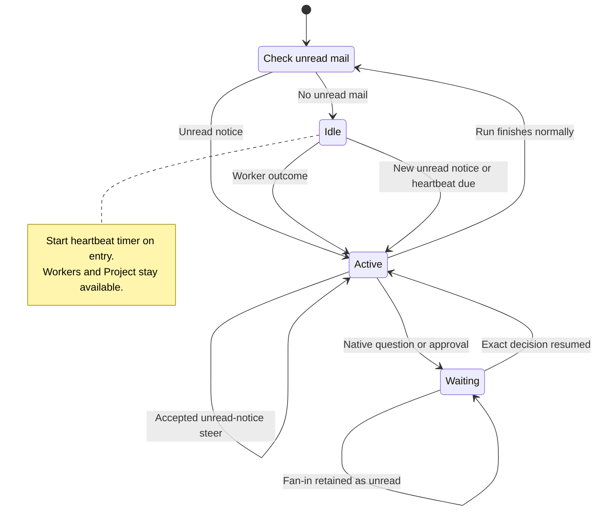

# Main Thread

## Input and Coordination

Each Claw has one persistent Main Thread. Main reads incoming messages, replies, coordinates work, and handles short tasks. It delegates long-running work to its managed worker Threads. Main and its workers use the Claw's [Project](04-project.md); the Main Thread keeps its identity across Runs and wakeups.

All user messages submitted to Claw, including from its input interface, first enter the [Inbox](01-inbox.md). After acceptance, Claw attempts an immediate steer of the active Main Run with a notice and short preview, or wakes idle Main. The steer is a best-effort notification, not a second submission of the message. If the notice cannot be delivered immediately, the message remains unread. Main chooses what to open and in what order.

Worker outcomes return through collaboration, with their worker and work identity. A heartbeat wakes the same Main after the configured idle interval. Native decision responses and execution controls are actions against the exact operation, not messages delivered to the conversation.

Claw enables all available native background execution tools by default for Main and its workers. Service's configured tool authority and execution policy still apply. Main uses background tools for operations that need to continue without blocking input handling; workers remain the owners of delegated long-running work.

## Activity and Idleness

Claw prompts Main again if a Run finishes and unread mail remains. Once Main can accept work, an unread notice can continue the same Thread. An outstanding native decision is a wait, not idleness: new mail can remain unread, but its notice and a heartbeat do not answer the decision or start a replacement Run. The response goes to the exact native wait. After continuation, Main returns to the same Inbox loop.

When Main has no active work or outstanding decision and no unread mail remains, it becomes idle and the heartbeat interval starts. A new unread notice or a worker outcome can bring Main back before that interval ends. If Main finishes that work and goes idle again, the interval starts again. An independently running worker does not by itself keep Main active; idleness does not stop that worker or the Project resources.

The diagram shows the normal work loop. Native failures, cancellation, and uncertain admission stay visible as such; they are not a normal completion or a reason to repeat an input whose outcome is unknown.
