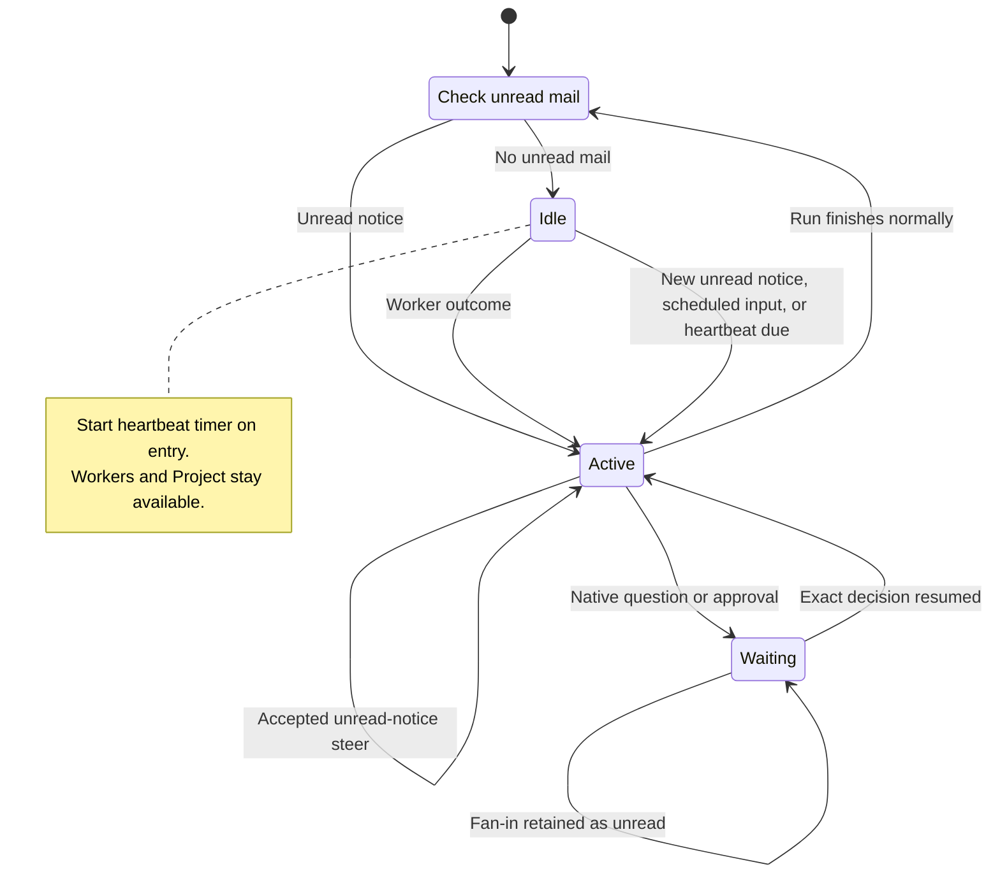

# Main Thread

## Input and Coordination

Each Claw has one persistent Main Thread. Main reads incoming messages, replies, coordinates work, and handles short tasks. It delegates long-running work to its managed worker Threads. Main and its workers use the Claw's [Project](04-project.md); the Main Thread keeps its identity across Runs and wakeups.

All user messages submitted to Claw, including from its input interface, first enter the [Inbox](01-inbox.md). After acceptance, Claw attempts an immediate steer of the active Main Run with a notice and short preview, or wakes idle Main. The steer is a best-effort notification, not a second submission of the message. If the notice cannot be delivered immediately, the message remains unread. Main chooses what to open and in what order.

Worker outcomes return through collaboration, with their worker and work identity. Main handles user-facing communication; ordinary user messages and coordination do not go directly to workers. A heartbeat wakes the same Main after the configured idle interval. Native decision responses and execution controls use Service's native controls against the exact operation, not messages delivered to the conversation.

Claw supplies Main and its workers with [capabilities and instructions](04-project.md#agent-composition) suited to their available resources. Main uses background tools for operations that need to continue without blocking input handling; workers remain the owners of delegated long-running work.

## Scheduled Work

Main chooses an execution mode when it creates a scheduled task. The default is a scheduled prompt queued as native input for the next Run of the same Main Thread, not a steer. This is not a user message and does not enter the Claw Inbox. Input follows native admission and does not answer or bypass a pending decision. Use this mode for ordinary tasks and work that needs continuity with Main's context.

For self-contained transactional work, Main can instead select a fresh native Thread in the same Project for each firing. Transactional describes the task's self-contained work, not a database atomicity guarantee. The task prompt directs the scheduled Thread to report its outcome to Main for any user-facing communication; it does not contact users directly.

Claw's instructions guide Main to create each task and write its trigger-time prompt:

- Choose the execution mode for the task, defaulting to Main's Thread and selecting a fresh Thread for self-contained transactional work.
- State the objective and context needed to execute the task, including the originating Thread and exact relevant source identifiers.
- Identify the execution target: Main's Thread for the default mode, or the new Thread created for that firing in fresh-Thread mode. A fresh Thread does not need a preallocated ID in the prompt.
- Specify how the outcome reaches Main and, when appropriate, the intended user-facing destination, including the exact relevant Thread or platform endpoint IDs. Do not assume an automatic broadcast or a particular result-routing API.

## Activity and Idleness

Claw prompts Main again if a Run finishes and unread mail remains. Once Main can accept work, an unread notice can continue the same Thread. An outstanding native decision is a wait, not idleness: new mail can remain unread, but its notice and a heartbeat do not answer the decision or start a replacement Run. The response goes to the exact native wait. After continuation, Main returns to the same Inbox loop.

When Main has no active work or outstanding decision and no unread mail remains, it becomes idle and the heartbeat interval starts. A new unread notice or a worker outcome can bring Main back before that interval ends. If Main finishes that work and goes idle again, the interval starts again. An independently running worker does not by itself keep Main active; idleness does not stop that worker or the Project resources.

The diagram shows the normal work loop. Native failures, cancellation, and uncertain admission stay visible as such; they are not a normal completion or a reason to repeat an input whose outcome is unknown.
