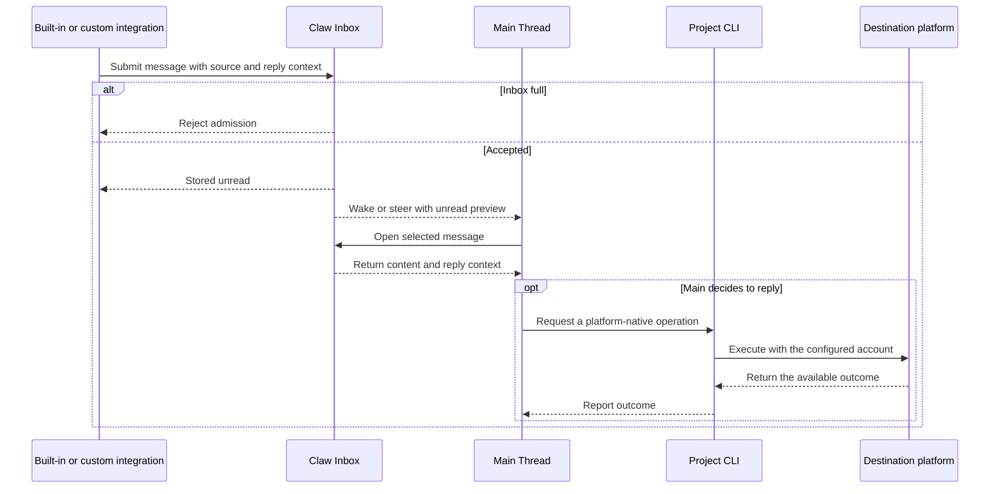

# Connectors and Replies

## Input Boundary

A connector binds to a specific Claw. Built-in connectors and operator-provided integrations submit messages through the same [Inbox](01-inbox.md) path. An incoming message carries its content and source context, such as the sender, conversation, original message, and reply target when available. The connector checks admission against its configured source and sender rules before submitting content. Message content is data; it does not choose the Project's executable or credentials.

The Feishu connector accepts direct messages that pass its configured source and sender rules. In group chats it accepts only messages that explicitly mention the bot by default. An operator can configure a bound group to accept messages without a mention. This changes only the mention filter: source and sender rules still apply, and accepted messages enter the same Claw Inbox.

The Lark connector also accepts configured bot-added, member-added, and Drive comment events. It requires an allowed, identifiable operator and, for chat events, an allowed group. It stores the event type and structured payload as untrusted source data; a Drive event uses a file-specific conversation identity.

Feishu attachment input includes its available metadata and source reference. The agent fetches the attachment on demand using the platform CLI in the Project Environment; the connector does not prefetch it. For message intake, Claw attempts a bounded snapshot of the parent, thread and recent chat messages, deduplicated and ordered chronologically, as untrusted source context. Missing permissions, timeouts, or malformed history do not prevent admission. The item also carries thread-reply guidance and a deterministic, provider-length-bounded reply idempotency key; a provider's idempotency window does not make an unknown outcome safe to retry indefinitely.

A connector can reflect Claw's Read state on the platform, for example with a reaction on the original Lark message. A GitHub connector accepts events from an authenticated external integration, polls Notifications with its stored token, or receives signed GitHub webhooks. Webhooks verify HMAC-SHA256 with a separate encrypted write-only secret before parsing the request. The configured bot login supplies mention and self-message filtering. Optional repository and required sender allowlists match case-insensitively. Supported events include created issue and review comments, opened issues and pull requests, and submitted pull request reviews. Admission deduplicates provider event identities across delivery IDs; an Inbox-full response allows redelivery. Accepted webhook events receive best-effort eyes feedback when a token and reaction target are available. Polling restricts repositories when configured, verifies an explicit bot mention, matches sender logins case-insensitively, and rejects the bot's own comments. A wildcard sender permits other identities. Initial lookback, maximum new-subject delay, polling interval, and optional mark-read are configured per connector. Polling follows HTTPS links only within the configured API origin and never forwards credentials through redirects or cross-origin pagination.

Polling stores an initial time boundary before its first provider request and a durable checkpoint only after all pages and eligible events have been processed. It overlaps scans by one minute and identifies comments by repository, comment type, ID, and update time; subject-only events use notification identity and update time. Admission identity is retained independently of Inbox retention. Inbox-full results leave the checkpoint unchanged. A Redis lease coordinates listeners, while durable admission and checkpoint state recover after restarts. GitHub's poll interval is a lower bound on request frequency. Conditional requests use the last successfully completed scan's modification time.

For an accepted polled GitHub event, Claw stores pending eyes feedback and retries it independently of Inbox admission. A missing or deleted reaction target is marked unavailable. Optional mark-read applies to the notification thread and does not mark it done; its pending state is also retried. These signals acknowledge delivery, not opening or completing the work. Intake feedback and Inbox-full errors are connector behavior, separate from Main's replies and not requiring an agent turn.

Lark connector changes reconcile after commit on Control replicas. Periodic reconciliation recovers missed notifications. Connection transitions are observations separate from saved credentials; an App ID leased by another connector reports a conflict. A superseded listener cannot admit messages under its old connection identity or credential.

When a failed Main Run relates to a Lark message, Control can reply in its conversation with a failure card and a Console Run link. The card exposes only an allowlisted, user-safe failure summary, not the Run's raw failure message. Its recovery token is bound to the Claw, failed Run, connector, and conversation. A click must come from a currently allowed sender and conversation under the current enabled connector and credential. Control admits at most one explicit native retry for the failed Run, and only while it is the idle Main Thread's latest failed Run. A success toast confirms committed retry admission, not completion. Control subsequently updates the card to show submission. Repeated clicks replay the same admission; stale cards cannot start another Run. Card delivery and patching are independently recoverable from admission, and an unconfirmed provider outcome is not proof of delivery. A failed retry can retain its originating Lark conversation without changing the original delivery history.

## CLI-First Replies

Main chooses the reply target and platform operation. It runs the corresponding CLI in the Project Environment. A reply can address the original message, its conversation, or another explicitly selected destination available to the configured account. The operation and payload follow the platform: for example, Lark text, rich messages, or files; GitHub issue comments, pull request comments, or reviews. Claw does not flatten these operations into a common text-only send format. Native Workers communicate with Main through the Service Thread Inbox, and Main can inspect their saved outcomes for publication.

The initial release supports GitHub and Lark/Feishu. Main uses their official CLIs, `gh` and `lark-cli`, and interprets the selected CLI's result.

## Project Setup

Workspace administrators configure a GitHub reply token or Lark App secret on a connector. Claw owns the write-only credential and encrypts it using Service key material. Omitting the credential preserves it, a replacement rotates it, and clearing it removes the stored value. Deleting a connector stops future intake and replies without deleting its delivery history. Credential checks return a secret-free diagnostic code and, when available, the provider HTTP status. The GitHub intake service account is separate from the reply identity. Credential checks, connector intake, CLI installation, and successful replies are distinct facts.

Claw attempts CLI provisioning after creating a Claw-owned managed Environment; failure does not block readiness. On supported Linux Environments, Claw probes the CLIs before the first model request of an eligible Main Run when the bound Environment has no complete cached version record. It reuses installed binaries and installs missing ones from the official latest release. Later Runs reuse that record until an update is queued or the Environment changes. An administrator can queue an update for the bound Environment; it runs before the first model request of the next eligible Main Run, and the request does not start a Run. An Environment replacement clears queued maintenance. A failed download or verification leaves the prior binary in place.

Administrators authorize at most one connector per platform for the selected Environment. Claw stores the original credentials encrypted in Control and uses Service Controlled HTTPS Egress to provide non-secret placeholders to the Project Session. The proxy injects the credential only into approved HTTPS request headers; it does not substitute bodies. Shared child Threads may inherit the parent's captured Session policy, so this is a shared Project capability, not Main-only isolation. Main remains responsible for user-facing replies. Environment replacement requires explicit reauthorization. Each request authorizing Project Egress names the Environment the operator reviewed; Control compares it with the current Project binding under the Claw lock and rejects a missing or stale value. Revocation stops further use of the managed credential; already frozen Runs and Session synchronization have separate completion boundaries.

When an otherwise unconfigured Thread binding first receives an authorized connector reference, Claw initializes controlled egress with public destinations. An explicit destination policy is preserved or the update is rejected; it is never widened. Credential removal queues durable revocation and Session-reference cleanup. Control revokes the Service credential before retrying cleanup of a busy or closed Thread. Operators can rotate or revoke the original provider credential when access must end immediately.

For Lark, Control exchanges the App secret for a short-lived tenant token and rotates the managed Egress credential after at most 75 minutes, with an expiry margin. The App secret never enters the Environment. For GitHub, `GH_TOKEN` supports the `gh` CLI and API calls that transmit the placeholder in a header. Ordinary Git HTTPS Basic authentication is not supported: Git base64-encodes the placeholder before it reaches the header substitution boundary. An unconfirmed command outcome remains unknown and is not authority to retry.

## Custom Channels

An operator can connect an unsupported platform without adding a built-in connector. Their integration delivers messages with source and reply context through the Claw input interface. A prepared Project Environment supplies the platform CLI, account access, and guidance Main needs to reply. The operator owns the custom integration and its platform feedback; Claw applies the same Inbox admission, read state, and wake behavior.

