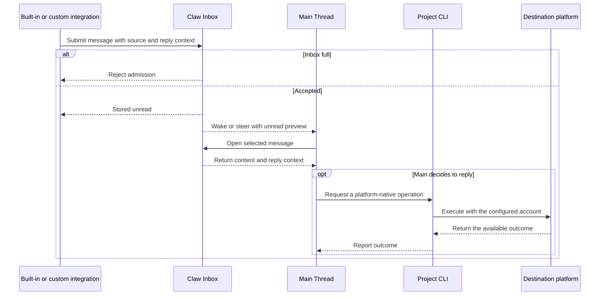

# Connectors and Replies

## Input Boundary

A connector binds to a specific Claw. Built-in connectors and operator-provided integrations submit messages through the same [Inbox](01-inbox.md) path. An incoming message carries its content and source context, such as the sender, conversation, original message, and reply target when available. The connector checks admission against its configured source and sender rules before submitting content. Message content is data; it does not choose the Project's executable or credentials.

The Feishu connector accepts direct messages that pass its configured source and sender rules. In group chats it accepts only messages that explicitly mention the bot by default. An operator can configure a bound group to accept messages without a mention. This changes only the mention filter: source and sender rules still apply, and accepted messages enter the same Claw Inbox.

Feishu attachment input includes its available metadata and source reference. The agent fetches the attachment on demand using the platform CLI in the Project Environment; the connector does not prefetch it.

A connector can reflect Claw's Read state on the platform, for example with a reaction on the original Lark message. When a GitHub-origin message is accepted into the Inbox, the integration adds an eyes reaction to its source where supported. This acknowledges delivery into the Inbox, not opening or completing the work. Claw does not provide built-in GitHub notification polling or mark-read. Intake feedback and Inbox-full errors are connector behavior, separate from Main's replies and not requiring an agent turn.

## CLI-First Replies

Main chooses the reply target and platform operation. It runs the corresponding CLI in the Project Environment. A reply can address the original message, its conversation, or another explicitly selected destination available to the configured account. The operation and payload follow the platform: for example, Lark text, rich messages, or files; GitHub issue comments, pull request comments, or reviews. Claw does not flatten these operations into a common text-only send format. Worker Threads communicate with Main through the [Inbox](01-inbox.md), and Main can inspect their saved outcomes for publication.

The initial release supports GitHub and Lark/Feishu. Main uses their official CLIs, `gh` and `lark-cli`, and interprets the selected CLI's result.

## Project Setup

When a new Claw creates its Project Environment, setup makes the selected CLIs, runtime configuration, and authorized account access available before the corresponding reply path is ready. Claw automatically installs missing official binaries in the Project Environment on supported platforms. Existing official binaries and account setup supplied by the operator are reused. Failed setup affects readiness for the corresponding reply path; it does not report a reply as sent.

The account presented to a CLI must be the account configured for the operation. Keep credential values in the configured credential mechanism, not in message content or readable Project settings. Main owns replies as a collaboration role. Workers with access to the same command environment and credentials have the same platform authority; sharing a Project does not by itself provide Main-only credential isolation.

## Custom Channels

An operator can connect an unsupported platform without adding a built-in connector. Their integration delivers messages with source and reply context through the Claw input interface. A prepared Project Environment supplies the platform CLI, account access, and guidance Main needs to reply. The operator owns the custom integration and its platform feedback; Claw applies the same Inbox admission, read state, and wake behavior.

