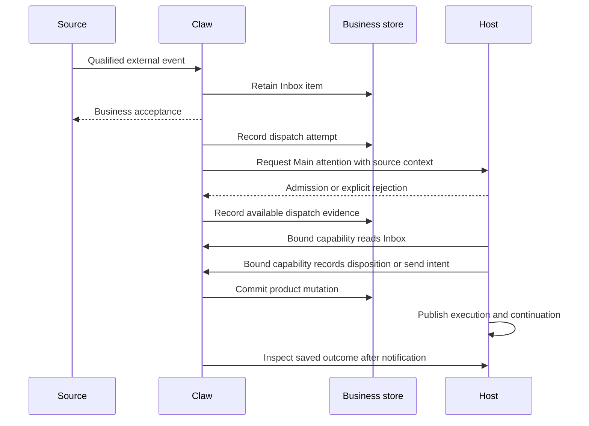

# Product Submission and Host Execution

## Design Position

The embedded Host is the sole execution owner. It serializes Thread advancement, resolves composition, runs Harness, manages decisions and children, publishes continuation, and exposes operation controls. Claw decides which business work needs attention and invokes that boundary; it does not define another Run lifecycle.

[Host integration](11-host-integration.md) owns the required library surface. [Persistence](04-persistence-and-recovery.md) owns evidence when a call or its result is uncertain. No product lock or dispatch record grants the right to advance Host history directly.

## Entry Paths and Acceptance

| Entry path                              | Claw responsibility                                                          | Execution acceptance                                             |
| --------------------------------------- | ---------------------------------------------------------------------------- | ---------------------------------------------------------------- |
| Direct Console or CLI conversation      | Authenticate, authorize, and forward the intended human input                | Host admission; no separate durable Claw input queue             |
| One Thread external message             | Durably retain an Inbox item; request content-light Main attention           | Host accepts the notification separately from Inbox acceptance   |
| Per-Channel external message            | Retain event identity, content, and target; request delivery to that Thread  | Host admission or steering, with product dispatch evidence       |
| Per-trigger external message            | Retain event and Channel Project; create and correlate one fresh task Thread | Host creation and admission are separate, with dispatch evidence |
| Automation occurrence                   | Retain occurrence and declared target; apply timing and overlap policy       | Host operation under current allowed selections                  |
| Worker collaboration or delegated child | Use native Host operations and relationships                                 | Native Host admission and control semantics                      |

Human input, external content, automation, and notifications retain their actual provenance. Product-triggered work must not be mislabeled as a direct human instruction. A method whose contract is limited to human submission cannot be reused for automated wake merely because its parameter accepts text.

## Submission and Active Work

Claw uses a supported Host start-or-steer operation where available. It does not decide from a stale status read that a new writer is safe. A successful receipt indicates Host admission, not durable input incorporation or business completion.

A busy or preparing Host, pending decision, shutdown, unavailable dependency, or rejected steer leaves retained business work pending with a reason. If the selected operation ends during a steer, Claw records the actual rejection or uncertainty. It never silently retargets an uncertain control call to a new operation. A later, demonstrably safe attempt can be scheduled under the recovery rules.

Direct human clients see the Host's actual rejection, control availability, and input semantics. Claw does not preserve the former standalone runtime's promise that every direct prompt is durably queued across restart. Retained external work remains inspectable even when the Host cannot currently accept it.

A product dispatch serializes attempts for its target and rechecks product eligibility before crossing the Host boundary. Host admission remains authoritative when direct human interaction or native collaboration races with it. Business records are committed before a potentially effectful call; no business transaction remains open across execution or a wait.

## Main Processing Flow

The product mutation and Host publication are separate commits. A saved handled disposition or delivery is not rolled back if later Host publication fails. A completed Host operation does not imply that an Inbox item was handled. Claw checks backlog again under [drain](10-one-thread-mode.md#wake-and-drain), respecting uncertainty and decisions.

## Decisions and Controls

Pending decisions belong to the Host. Claw presents exact requests and forwards authorized answers with their original correlation and preconditions. Ordinary prompts, Inbox notifications, timers, and workers cannot answer an approval or resume past a waiting decision by implication.

A lost decision-response result is reconciled through the Host's available evidence, not replayed against a new request. Claw does not create a separate deferred-response store or reconstruct native answers from rendered text. A platform unable to represent the interaction directs the user to a capable authorized surface.

Stopping an operation invokes Host cancellation and reports its observed outcome. It does not stop every worker, undo effects, or pause future Inbox processing. Pausing automatic product dispatch is a separate durable Claw setting. Claw keeps that setting aligned with any enabled Host coordinator auto-follow-up through the supported integration boundary; a second automatic wake path must not bypass pause.

## Delegation and Persistent Workers

Host-native delegated children and Coordinator-owned worker roots keep their native distinction. Claw does not recreate either mechanism, synchronize their histories into Main, or wrap them in durable Claw Runs. Creation and first-prompt admission retain their separate Host outcomes; a partial failure reports the known Thread identity.

Claw uses saved Host views to assess results. A worker notification is a hint, not proof of success or a durable report. Business dependencies on worker results are retained separately and resolved from exact available saved evidence. Missing evidence blocks the dependency; it does not authorize rerunning the worker task.

## Invariants

1. Only the Host owns execution state transitions, checkpoints, and decisions.
2. Product acceptance never implies Host acceptance or durable execution input.
3. Direct human, external, and automated input keep distinct provenance.
4. Rejected or uncertain control does not fall through into another operation.
5. Product settlement, Host completion, cancellation, and external delivery remain separate outcomes.
