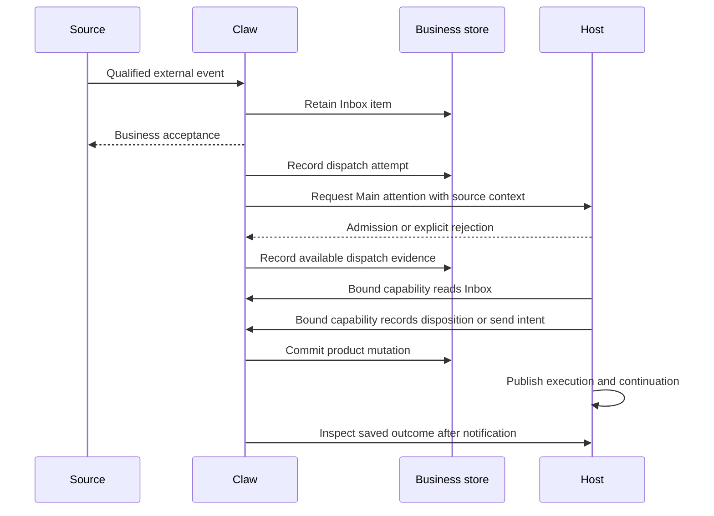

# Product Submission and Host Execution

## Design Position

The embedded Host is the sole execution owner. It serializes Thread advancement, resolves composition, runs Harness, manages decisions and children, publishes continuation, and exposes operation controls. Claw decides which business work needs attention and invokes that boundary; it does not define another Run lifecycle.

[Host integration](11-host-integration.md) owns the required library surface. [Persistence](04-persistence-and-recovery.md) owns evidence when a call or its result is uncertain. No product lock or dispatch record grants the right to advance Host history directly.

## Entry Paths and Acceptance

| Entry path                              | Claw responsibility                                                          | Execution acceptance                                                |
| --------------------------------------- | ---------------------------------------------------------------------------- | ------------------------------------------------------------------- |
| Explicitly targeted human interaction   | Authenticate, authorize, and forward input from IM, CLI, or API              | Host admission or exact-operation steering; no durable prompt queue |
| One Thread external message             | Durably retain an Inbox item; request content-light Main attention           | Host accepts the notification separately from Inbox acceptance      |
| Per-Channel external message            | Retain event identity, content, and target; request delivery to that Thread  | Host admission or steering, with product dispatch evidence          |
| Per-trigger external message            | Retain event and Channel Project; create and correlate one fresh task Thread | Host creation and admission are separate, with dispatch evidence    |
| Automation occurrence                   | Retain occurrence and declared target; apply timing and overlap policy       | Host operation under current allowed selections                     |
| Worker collaboration or delegated child | Use native Host operations and relationships                                 | Native Host admission and control semantics                         |

A human message received through IM is human input with external source context. Claw retains platform, connection, Channel, sender, and event attribution in business records and supplies relevant context with the Host input. Automation and content-light notices identify their actual cause. This requires truthful content and compatible observable Host behavior, not a new Host-wide provenance field or separate admission API. [Host integration](11-host-integration.md#input-and-wake-semantics) owns compatibility with the selected package.

## Submission and Active Work

For input addressed to an existing Thread, Claw observes its current Host operation. If active and steerable, it steers that exact operation; if inactive, it requests submission through the public Host API. The Host serializes admission. A stale observation can produce a rejection, never permission to create a second writer. This thin selection between public calls does not require a new atomic start-or-steer API. A successful receipt indicates Host admission, not durable input incorporation or business completion.

Ordinary IM messages follow the selected routing mode: One Thread retains the body in Inbox and sends Main attention, per-Channel continues its conversation, and per-trigger creates a fresh task. Explicit continue, steer, stop, and decision actions address a known Thread or operation instead of re-entering new-message routing. An ambiguous target is shown for selection, not guessed from the most recently active Thread. [Bridges](07-bridges-and-clients.md#interactive-im-behavior) owns platform presentation.

A Host operation that cannot currently accept the requested input, pending decision, shutdown, unavailable dependency, or rejected steer leaves retained business work pending with a reason. If the selected operation ends during a steer, Claw records the actual rejection or uncertainty. It never silently retargets an uncertain control call to a new operation. A later, demonstrably safe attempt can be scheduled under the recovery rules.

Direct human clients see the Host's actual rejection, control availability, and input semantics. Claw does not preserve the former standalone runtime's promise that every direct prompt is durably queued across restart. Retained external work remains inspectable even when the Host cannot currently accept it.

A product dispatch serializes attempts for its target and rechecks product eligibility before crossing the Host boundary. Host admission remains authoritative when direct human interaction or native collaboration races with it. Business records are committed before a potentially effectful call; no business transaction remains open across execution or a wait.

## Main Processing Flow

The product mutation and Host publication are separate commits. A saved handled disposition or delivery is not rolled back if later Host publication fails. A completed Host operation does not imply that an Inbox item was handled. Claw checks backlog again under [drain](10-one-thread-mode.md#wake-and-drain), respecting uncertainty and decisions.

## Decisions and Controls

Pending decisions belong to the Host. Claw presents approvals and structured questions, then forwards authorized answers with their original Thread, request, continuation, and response-kind correlation. Multiple pending requests retain Host batch and partial-response semantics; one button must not imply approval of unrelated requests. Ordinary prompts, Inbox notifications, timers, and workers cannot answer an approval or resume past a waiting decision by implication.

Claw may retain the platform message/callback association needed to address and deduplicate an interaction; the Host remains the decision authority. A lost decision-response result is reconciled through available evidence, not replayed against a new request. Claw does not reconstruct native answers from rendered text. A platform unable to represent the interaction directs the user to an available authorized CLI or other capable surface, reporting the limitation when none is configured.

Stopping addresses one current Host operation, invokes native cancellation, and reports request acceptance separately from observed termination. It does not stop every worker, undo effects, settle Inbox items, or disable future messages and native follow-up. Interrupted business work is reconciled before any retry; cancellation is not proof that its effects did not occur. Claw adds no durable global pause state and does not intercept all Host starts. Connection enablement, automation enablement, and shutdown keep their separate scopes.

## Delegation and Persistent Workers

Host-native delegated children and Coordinator-owned worker roots keep their native distinction. Claw does not recreate either mechanism, synchronize their histories into Main, or wrap them in durable Claw Runs. Creation and first-prompt admission retain their separate Host outcomes; a partial failure reports the known Thread identity.

Claw uses saved Host views to assess results. A worker notification is a hint, not proof of success or a durable report. Business dependencies on worker results are retained separately and resolved from exact available saved evidence. Missing evidence blocks the dependency; it does not authorize rerunning the worker task.

## Invariants

1. Only the Host owns execution state transitions, checkpoints, and decisions.
2. Product acceptance never implies Host acceptance or durable execution input.
3. Direct human, external, and automated input keep distinct provenance.
4. Rejected or uncertain control does not fall through into another operation.
5. Product settlement, Host completion, cancellation, and external delivery remain separate outcomes.
