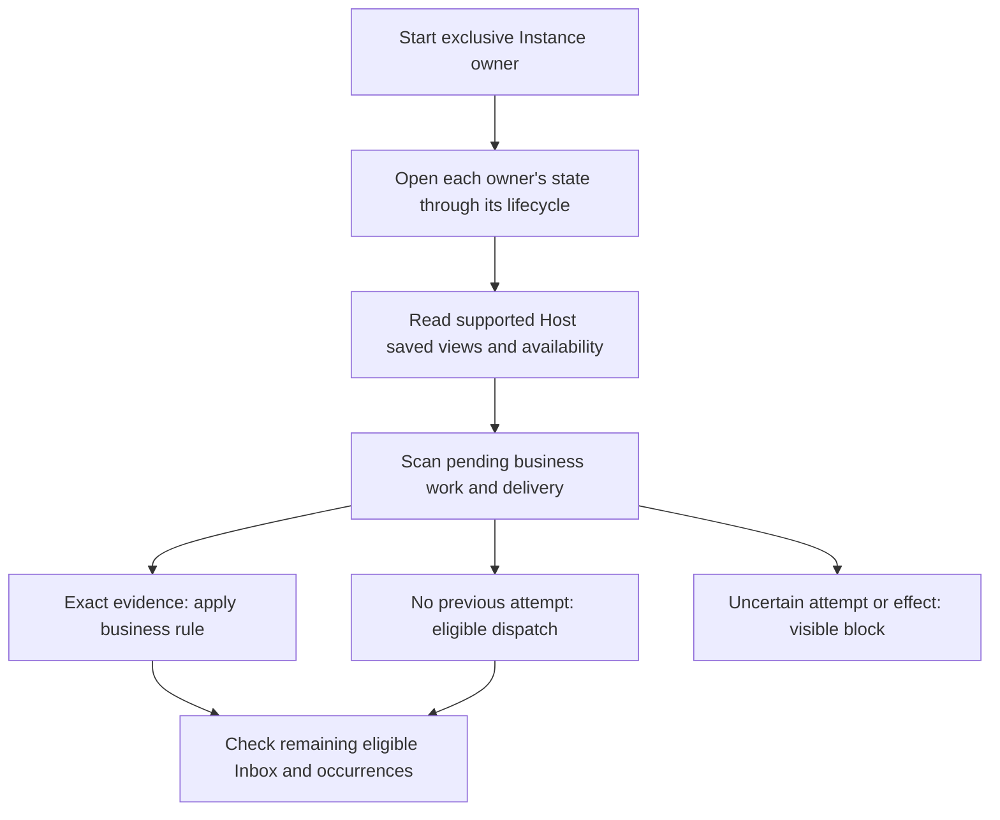

# Persistence, Recovery, and Retention

## Design Position

Claw durably retains business obligations. Harness UI owns its configuration and saved execution state, with its native local-continuation guarantees. Embedding does not make Host receipts, pending inputs, deferred responses, or active operating-system processes recoverable durable jobs.

There is no cross-owner transaction between business acceptance, Host admission, a tool's external effect, and Host checkpoint publication. Claw records uncertainty at those boundaries instead of maintaining a second execution log or promising exactly-once execution.

## Storage Ownership

| State                                                                                 | Owner and access                     |
| ------------------------------------------------------------------------------------- | ------------------------------------ |
| Host resources and accepted configuration generations                                 | Host configuration APIs              |
| Thread metadata, roles, worker relationships, execution summaries, and continuation   | Host commands and detached queries   |
| Environment associations, Thread files, memory, and organization state                | Host-supported resource operations   |
| Connections, bindings, canonical Main reference, and platform interaction correlation | Claw business store                  |
| Inbox content, dispositions, dependencies, and dispatch evidence                      | Claw business store                  |
| Automation definitions, occurrences, and business workflow progress                   | Claw business store                  |
| Delivery content, destination, and transport evidence                                 | Claw business store                  |
| Live operation handles and event subscriptions                                        | Process-local; not restart authority |

Physical database placement does not change ownership. Claw migrations never edit Host tables, immutable objects, checkpoint selectors, or memory bookkeeping. A copied Host receipt remains a reference whose later availability follows the Host contract. Retained product evidence records what was observed, not a competing live execution state.

## Dispatch Evidence

For each Inbox wake, per-Channel input, per-trigger task creation/submission, or automation occurrence, Claw distinguishes:

| Evidence                                                     | Meaning and next action                                                          |
| ------------------------------------------------------------ | -------------------------------------------------------------------------------- |
| No dispatch attempt                                          | Business work is retained and eligible for a first attempt after policy checks   |
| Attempt recorded, no conclusive response                     | The Host may have accepted work; block automatic retry                           |
| Explicit rejection before acceptance                         | Work remains pending; retry may be scheduled if its cause is safely resolved     |
| Host acceptance observed                                     | Retain available references; inspect rather than resubmit                        |
| Exact saved outcome or explicit business settlement observed | Apply the owning business rule; do not infer unrelated tool or delivery outcomes |

Claw commits the attempt marker before invoking the Host and records the response afterward. A crash in between can conservatively block work even if the call never happened. This is an accepted availability trade-off. It avoids silently repeating an action without requiring a durable Host admission protocol.

A generic exception, missing receipt, idle Thread, newer unrelated checkpoint, or absent final reply is not evidence of rejection. Correlation requires exact Host references or explicit business evidence. Where the supported Host view cannot establish the original outcome, the item stays visibly blocked for operator review. Matching prompt text or timing is not a substitute.

An authorized operator may record a resolution: settle or discard the obligation, confirm it was not applied using available evidence, or explicitly authorize a new attempt acknowledging possible repetition. The prior attempt and reason remain inspectable. This resolves product policy only; it does not modify Host execution history, clear a Host decision, or prove an external process stopped.

Uncertainty belongs to the affected attempt, obligations, and effects. They stay out of actionable processing until resolved, including when Main starts through native collaboration. Unrelated work and Host-native controls remain available. If the evidence cannot delimit which items an attempt may have affected, Claw conservatively retains that affected set for reconciliation; it does not invent a global Host execution gate. These exceptional cases do not add a confirmation step to ordinary accepted messages.

## Restart Flow

Claw scans pending obligations on startup, Host settlement signals, barrier release, and bounded reconciliation opportunities. Live events only accelerate discovery. A lost Run-end callback cannot erase pending business work; an ambiguous dispatch can still prevent automatic execution until resolved.

The Host decides whether a saved Thread can continue, whether a decision is available, and what saved execution state means. Claw does not rewrite foreign running markers, reacquire old receipt authority, replay deferred answers, or synthesize interrupted Runs. A graceful Host restart feature is usable only when the embedding lifecycle explicitly supports it; it is not a crash-recovery guarantee.

For One Thread mode, an explicitly settled Inbox item remains settled even if the later Host checkpoint failed. Unsettled items that an ambiguous attempt may have affected remain blocked until reconciled; a new native Main operation is not proof that those items are safe to repeat. Delivery uncertainty is reconciled separately. Worker dependency discovery uses saved Host facts; missing transient reports are not reconstructed as successful work.

## Upgrades and Existing Data

Each owner applies its own forward migrations before its operations become available. A Host upgrade failure blocks Host use; a Claw business migration failure blocks product dispatch. Neither failure resets the other owner's state. Compatibility failures remain actionable and preserve retained data.

The old standalone Claw database is not a Harness UI store. This redesign promises no automatic conversion of its Profile, Run, checkpoint, environment, or private-memory semantics. An embedding implementation must reject incompatible roots and offer an explicit fresh-instance or separately specified import path. This specification authorizes no deletion or in-place reinterpretation of existing data.

## Retention and Backup

Archiving a Host Thread, removing a Channel, deleting business records, deleting memory, and destroying an environment are distinct operations under their owners. Removing a referenced Host resource leaves a visible blocked product reference unless an authorized action explicitly resolves the affected obligations. It never silently routes old work to a replacement Thread.

Retain content needed by unsettled items, workflow dependencies, and deliveries. Product deletion coordinates with active product calls and does not bypass Host retention rules. Saved outgoing content can be delivered without reconstructing or rerunning the Agent.

A recoverable backup covers the Host store and its referenced files, selected configuration and memory, and Claw business state at a coordinated quiescent boundary. Copying two live databases independently is not an atomic application snapshot. Working directories, containers, and external systems have their own retention; restoring a backup does not reverse external effects.

## Invariants

1. Retained business work survives restart without implying durable Host execution admission.
2. Unknown dispatch or effects block replay until an explicit safe resolution or risk-acknowledged new attempt.
3. Claw never edits Host persistence to manufacture liveness, completion, or recovery authority.
4. Inbox settlement and delivery evidence survive independently of Host checkpoint publication.
5. Recovery may leave work blocked; it must not silently lose it or repeat it to manufacture progress.
