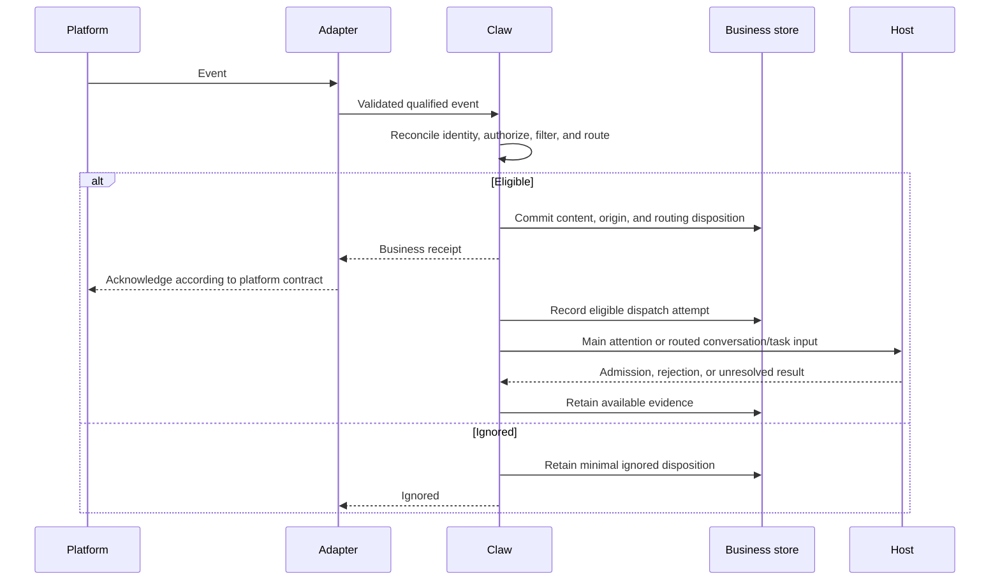

# Bridges, Ingress, and External Delivery

## Design Position

Messaging adapters run inside the Claw process. They own platform connection and representation; Claw owns sender policy, routing, retained business input, and delivery. Execution belongs to the embedded Host. A new adapter adds no Thread store, Agent loop, or bridge-to-Host HTTP service.

Lark, Discord, WhatsApp, and Telegram remain adapter targets, not a claim that all are implemented or feature-equivalent. Each adapter reports its actual authentication, mention, attachment, reply, and decision capabilities.

## Qualified Identity and Routing

A connection identifies one platform account or installation. A Channel identifies a conversation within that platform and connection, including reply-thread distinctions where relevant. Sender and message identities remain qualified; display names never identify authority.

A binding specifies permitted participants, group filtering, routing, and destinations. Routing has three modes:

| Mode        | Target for an eligible new event                                   |
| ----------- | ------------------------------------------------------------------ |
| One Thread  | The canonical Main Inbox; Main and workers share one Host Project  |
| Per-Channel | The Channel's persistent Host Thread in its stable Channel Project |
| Per-trigger | A new task Host Thread in the Channel's stable Channel Project     |

[Memory](09-memory.md#scopes-and-sharing) owns Project mapping and sharing. Channel Projects are provisioned through supported Host configuration operations and referenced by bindings. A Channel name change does not change its Project identity. Creating a previously unbound Channel's Project or Thread follows explicit setup policy; partial creation/admission failure retains known identities rather than repeating creation blindly.

Rebinding affects new events. Retained work keeps its original source, target context, and intended destination; current authorization can block further use. Disabling a connection stops new ingress or egress under policy without cancelling Host work by implication. No pending reply is silently redirected.

Sharing a Thread or Main across Channels explicitly shares Agent context. Host memory and working context can also be shared across distinct Threads. Binding disclosure follows [access](06-api-console-and-access.md#access-boundary); routing is not permission to browse Host history or every Inbox item.

## Per-trigger Tasks

Each distinct eligible trigger creates a fresh Host root Thread with no continuation or copied history from an earlier task, including earlier tasks in the same Channel. All of that Channel's task Threads select its stable Project and therefore share Channel memory plus Global memory. With mentions-only filtering, each new eligible mention starts a separate task; an active previous task is not an implicit steering target. With all-messages filtering, each otherwise eligible new message is a trigger.

The qualified event retains its task Thread association. Claw serializes creation attempts for that event and records intent before the Host call under [dispatch evidence](04-persistence-and-recovery.md#dispatch-evidence). Duplicate platform delivery reuses the event's disposition and any known Thread reference; unknown creation or submission blocks automatic recreation. Separate events can have separate task Threads, subject to Host capacity and product admission policy.

A task can span multiple Host operations, pending decisions, and explicitly targeted human continuation. Exact decision callbacks and authorized controls address the existing task rather than creating another one. An ordinary new eligible message starts a new task even if it quotes or replies to an earlier task; it does not implicitly resume that task. Completion retains the Thread for inspection under ordinary retention rules. A task Thread is not a second Claw execution state machine.

## Filtering and Deduplication

Group filtering supports all otherwise authorized messages or mentions-only, with a connection default and binding override. Filtering is independent of routing mode: mentions-only can be combined with One Thread, per-Channel, or per-trigger routing. Mentions come from platform identity metadata, not matching a bot name in text. Direct messages still require sender authorization. A quoted bot message or reply alone is not a mention. If the adapter cannot establish mentions, mentions-only cannot silently act as all-messages.

Claw first reconciles a known event identity, then checks current sender and binding policy for new admission. Duplicate delivery retains the prior disposition without granting newly revoked content access. Conflicting reuse fails. Group filtering occurs before Host Thread creation, Inbox content retention, attachment collection for execution, or model invocation.

Ignored events retain only the identity and minimal disposition needed for deduplication and diagnostics. Ignored bodies cannot re-enter through previous-message context, hidden prompts, memory extraction, or a later filter change. Echoes and service-originated output are excluded. Exact decision responses and authorized controls have their own validation; they need not contain a textual mention.

## Ingress Flow

Transport acknowledgement is not execution completion. Essential attachments are retained or explicitly reported unavailable; temporary download URLs alone cannot promise future content. Attachment access remains scoped to the original admitted event and current policy.

In One Thread mode, Main receives a content-light notice and reads selected Inbox content through Claw's Capability. In per-Channel and per-trigger modes, the retained message is submitted to its selected conversation or task Thread through supported Host operations. All three modes use [dispatch evidence](04-persistence-and-recovery.md#dispatch-evidence); retained input does not imply that the Host durably consumed it. Rejected work can remain pending, and uncertain work blocks replay.

## Decisions and Controls

Adapters present only interactions supported by both platform capability and caller authority. A response identifies the exact Host pending request and external actor. Button delivery, ordinary chat, repeated callbacks, and quoted approval text cannot authorize execution.

Claw forwards an authorized response through the Host decision boundary and reports its actual outcome. It does not retain a second approval engine or synthesize recovery answers. Unsupported interactions direct the user to an authorized capable frontend without weakening the decision.

## Egress and Reconciliation

A delivery retains explicit content, qualified destination, source evidence, and request identity before a transport attempt. Reusing the same delivery request with identical content returns its disposition; conflicting content or destination fails. Adapter formatting, splitting, and updates retain the original delivery association and report partial or unknown outcomes.

In One Thread mode only canonical Main can request Agent-originated external sends through Claw. Main's final answer and worker output are not automatically broadcast. In per-Channel and per-trigger modes an authorized reply policy may select a particular saved Host result for its original destination; Claw does not select unrelated later output. If the result cannot be correlated, delivery waits for resolution.

Before dispatch, Claw checks current connection and destination authority. Adapters distinguish confirmed success, definite non-send failure, and unknown outcomes. A usable platform idempotency key or status query can support safe retry. A possibly successful send without such evidence remains unknown; an operator resolution records its evidence or acknowledged duplication risk. There is no exactly-once promise for arbitrary platforms.

Retry delivery from saved content, never by rerunning the Agent. Inbox settlement and Host completion do not imply delivery success. Streamed presentation is optional and cannot replace retained send intent. Secrets, hidden reasoning, unrelated history, and unauthorized files are excluded from platform output.

## Invariants

1. Platform acknowledgement, business retention, Host admission, and external delivery are independent.
2. Deduplicated ingress does not become an unproven exactly-once Host execution guarantee.
3. Ignored content never enters execution through another context path.
4. Delivery failure does not rewrite Host outcomes or trigger Agent re-execution.
5. Shared context never implies unrestricted recipient fan-out.
6. Per-trigger routing creates one fresh task per distinct eligible event, not per redelivery or decision callback.
7. Mentions-only filters admission independently of Thread lifetime and memory sharing.
