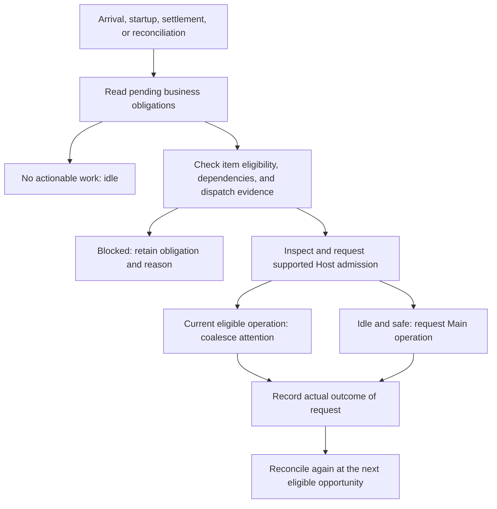

# One Thread Mode and Business Attention

## Design Position

One Thread centralizes external conversation handling in one canonical Main Host Thread. Claw owns the Inbox and product dispatch policy. The Host owns Main's Coordinator role, worker relationships, execution, continuation, and native collaboration. Persistent business attention does not turn Host collaboration receipts into a durable message bus.

[Execution](03-execution-lifecycle.md), [recovery](04-persistence-and-recovery.md), and [bridges](07-bridges-and-clients.md) own the shared boundaries. This document owns product mode, Inbox processing, and Main publication policy.

## Instance Mode and Lifetime

New Instances default to One Thread mode. Per-Channel and per-trigger modes remain explicit alternatives under the [routing contract](07-bridges-and-clients.md#qualified-identity-and-routing). The mode is selected for the whole Instance at startup; an existing saved selection is not changed by a new default. Per-Channel mode reuses the Channel's conversation Thread; per-trigger mode creates a fresh task Thread for each eligible event. One Thread mode retains messages for selective Main processing. Mentions-only is an independent admission filter for every mode.

Claw retains exactly one canonical Main reference. Main is a Host Coordinator root established through supported Host operations in one fixed shared Project. Main and its native workers use Global plus that Project's memory across all participating Channels, without Channel partitions or Channel-specific memory restrictions. This mode requires no per-Channel Projects or cross-Project memory extension. Ordinary create, fork, archive, or worker operations do not silently replace it. If its reference, role, or required context is unavailable, product dispatch blocks rather than creating a new coordinator automatically.

A mode switch or Main reset is an explicit administrative change at an Instance shutdown/startup boundary after accounting for active Host work and unresolved effects. It does not merge histories or memory, retarget old pending items, or erase uncertainty. Memory selection and retained Channel Project references follow the [memory transition rules](09-memory.md#configuration-and-updates). Retained old-mode work is explicitly left inactive or resolved; destructive removal is a separate authorized action.

## Persistent Worker Collaboration

Main creates and manages workers through Host-native collaboration. Worker identity, owner, Project relationship, creation defaults, and control scope come from the Host. Claw does not copy an ownership graph or promise atomic worker creation plus first-prompt execution. Known partial creation is inspected rather than repeated.

Main can discover and inspect owned workers and send follow-up through the Host. Workers can report or ask their owner under native scope rules; they cannot gain arbitrary sibling access or Main publication authority. Run-scoped subagents retain their separate Host contract and do not become persistent workers by being renamed.

Host collaboration messages and lifecycle notifications retain best-effort, process-local delivery semantics. Claw does not promise that an unsaved worker message survives a crash. For a business item deferred on worker work, Claw retains a dependency reference and reconciles exact saved worker evidence. A terminal notification prompts a query; it does not establish success. Missing or overwritten correlation evidence becomes a visible dependency blockage rather than a replay request.

Authorized users can inspect and converse directly with workers through explicitly targeted IM, CLI, or API interactions. For input submitted through Claw, retained product attention references the original submission and any uncertainty, including later user input outside the Host's first-start notification. Claw coalesces its own attention; native owner notifications keep their best-effort behavior and can overlap. Both refer to already-requested work, which Main inspects instead of recreating.

Native worker messages and coordinator auto-follow-up remain Host-owned and can start or steer Main under Host rules. Claw does not disable them to make Inbox drain the sole wake path, or require a common admission hook. Drain only submits attention for eligible Claw obligations. Native collaboration can race with that request; Host admission and exact-operation control resolve the race. An unrelated native start does not resolve a blocked Inbox attempt or authorize its replay.

## Durable Inbox

After sender authorization and group filtering, Claw retains eligible external messages with qualified origin, event identity, content, attachment availability, and routing context. Duplicate events return the retained disposition. A business receipt can precede any Host operation.

Main receives bounded content-light attention and uses a native Claw Capability to read admitted items and authorized context. Inbox is the message collection and selective-reading surface, not a human approval queue before normal interaction. Notices are not duplicate message bodies or instructions to rerun an already submitted task. Reading does not settle responsibility.

| Disposition | Business meaning                                                    |
| ----------- | ------------------------------------------------------------------- |
| Pending     | Needs Main attention when dispatch is safe                          |
| Deferred    | Waits on a recorded dependency, time, or human resolution condition |
| Handled     | Explicitly settled with a recorded result or reference              |
| Ignored     | Explicitly dismissed with a reason                                  |

Disposition updates check the current item state so a stale response cannot erase a newer reactivation. Notification, reading, a Host checkpoint, or successful operation completion does not mark an item handled. Business blockage and dispatch uncertainty are visible separately from disposition. Actionable Inbox views exclude items whose dispatch or effects require reconciliation; inspection shows their evidence and reason. This remains true when Main starts through a native worker message rather than Claw drain. Ordinary settlement cannot clear uncertainty or authorize a retry; resolution follows the [recovery contract](04-persistence-and-recovery.md#dispatch-evidence).

Deferral names an exact dependency where evidence is available, not merely a worker that may later do unrelated work. Claw checks whether the condition is already satisfied when recording deferral and checks it again during reconciliation. Saved success, failure, or cancellation can reactivate the linked item for review. Unknown worker progress exposes a block; unrelated activity does not reopen every deferred item. Time conditions and human-resolution gates survive restart. Handled and ignored items remain settled until explicitly reopened.

## Wake and Drain

Drain scans retained actionable Inbox and product attention. It runs on arrival, startup, observed Main settlement, release of a blocking condition, and bounded periodic reconciliation. Periodic reconciliation inspects state; it does not itself require model inference. Hooks accelerate processing but are not the only way to find work.

Claw serializes its own wake attempts and coalesces backlog; the Host remains the authority for Thread admission. Concurrent direct human input can still win admission, and rejection leaves backlog pending. Main receives at most the bounded attention needed for the active attempt rather than one operation per item.

After a known Main completion, remaining pending items require another eligible check even when the Agent declared completion and no external event arrived. A new operation uses Host continuation and configuration rules. A crash before a notification cannot erase backlog, but an unresolved prior dispatch or effect blocks retry of the affected work under [recovery](04-persistence-and-recovery.md#dispatch-evidence).

Pending decisions, shutdown, revoked authority, and missing Host context prevent Claw dispatch to the affected target. Dispatch uncertainty excludes affected obligations from automatic processing; it is not a global prohibition on Main or worker execution. An active operation's outcome and delivered steering must be accounted for before repeating its attention request. Unknown is never treated as proof that the work was not applied. Stopping follows [native cancellation](03-execution-lifecycle.md#decisions-and-controls).

Failed or non-progressing work retains backlog with a controlled retry time or explicit operator block. Backoff has a recoverable next check. Attempt limits do not convert pending work into handled work. A known-safe new attention request is distinct from repeating an uncertain prior input or external effect.

## Messaging and External Publication

Claw's Messaging Capability provides bounded Inbox listing, authorized reads, disposition changes, explicit sends, and delivery inspection. Every call uses Host-bound actual Thread identity and current product authority.

Only canonical Main can request Agent-originated external sends in One Thread mode. Workers return results through Host collaboration; they receive no Claw send authority or alternative product credential route. Model text, resource selection, a copied ID, or a guessed Channel cannot impersonate Main. Broad host-account execution and trusted operator code are not isolated by this model-tool rule.

Main's final response is not a broadcast. A send names content and an explicit currently permitted destination and is retained under the [delivery contract](07-bridges-and-clients.md#egress-and-reconciliation). Exact authorized decision presentation is a separate interaction, not general worker publication. No additional message-freshness or multi-bot arbitration gate is introduced.

Handled Inbox state, saved Host outcome, and confirmed external delivery remain independent. A handled item may reference a pending or unknown delivery; the delivery is reconciled without rerunning Main. Main and workers share knowledge according to [Host memory](09-memory.md) and their selected working context, not retired Thread-private semantics.

## Acceptance Scenarios

1. Pending never-attempted Inbox work is discovered after restart without another platform event.
2. A known completed Main operation with pending items leads to another eligible check; lost callbacks do not strand backlog.
3. An ambiguous Host call leaves visible pending work but blocks automatic replay, including after restart.
4. Concurrent arrival, completion, and repeated scans do not create competing Claw wake attempts; Host rejection remains authoritative.
5. Reading and notification never settle work; deferral handles already-completed and racing dependencies.
6. Native worker reports and configured auto-follow-up can start or steer Main while Claw drain coalesces its own requests; a blocked item stays excluded from actionable Inbox until reconciliation.
7. A worker cannot publish externally through Claw; direct human worker interaction is not redispatched as a new task by Main.
8. Worker ownership is rediscovered from Host state, and missing transient reports are not manufactured as saved success.
