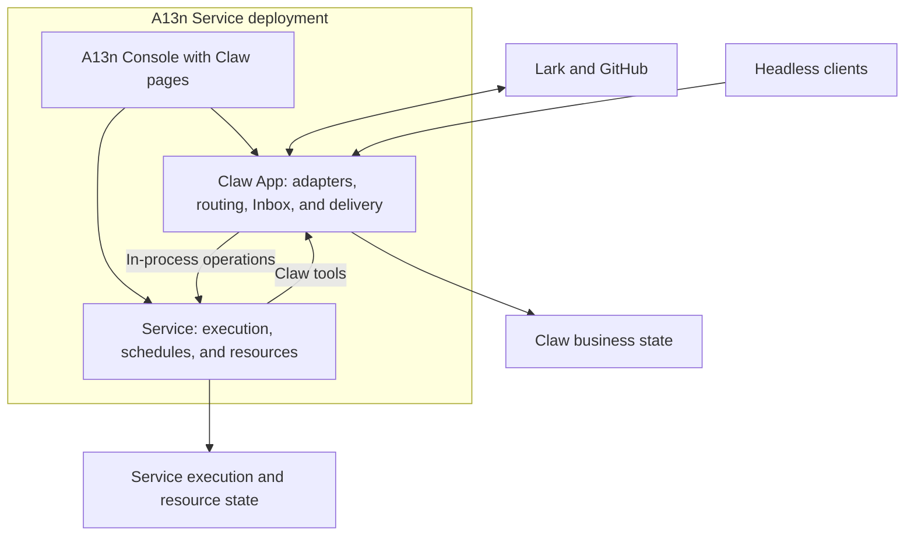

# Service App Overview

## Product Position

Claw brings interactive agent work to messaging platforms. Users send tasks, add context, answer questions and approvals, stop a selected operation, work with persistent workers, and receive results and files. IM is the conversation surface; the operator Console and headless tools support setup, inspection, and operations.

Claw runs as an App plugin within A13n Service. It owns the messaging product and its business state. Service owns agent execution and its resources. Claw extends A13n Console with Overview, Runs, Models & Accounts, and Schedules; the pages use the Console's login, workspace selection, and navigation. Headless configuration, inspection, and operational workflows remain available.

## Architecture

Claw calls Service operations directly in process. Service operations keep the same authority and semantics regardless of whether their caller is a native route or an App. Claw applies sender, Channel, and delivery policy in addition to Service workspace and resource authorization. An external reference to a Thread or Run identifies work; it does not grant access to it.

| Concern                                                                              | Owner                    |
| ------------------------------------------------------------------------------------ | ------------------------ |
| External connections, sender policy, Channels, routing, business Inbox, and delivery | Claw                     |
| Thread, Entry, Run, decisions, continuation, and worker execution                    | Service                  |
| Schedule timing and occurrence execution                                             | Service                  |
| IM schedule requests, their author and destination, and result notifications         | Claw                     |
| Models, provider accounts, usage facts, memory, environments, files, and browsers    | A13n                     |
| Claw operator workflows and pages                                                    | Claw within A13n Console |

Claw retains external business state and its references to Service Threads, Entries, and Runs in its own App database tables. A Thread identifies a conversation; an Entry identifies an admitted input that may still be waiting for a Run. Service owns execution history; the App owns the association to the external message. Claw does not use Service metadata as its business store.

## Workflows

- **Messaging.** Lark provides interactive work, decisions, progress, and text and file delivery. GitHub provides notification intake and issue or pull request replies. One Thread mode is the default and directs eligible messages to a durable Inbox for a canonical Main Thread. Per-Channel mode keeps a conversation Thread for each Channel; per-trigger mode starts a new Thread for each eligible event while retaining the Channel's working context. Mentions-only filtering is independent of the routing mode.
- **Execution.** Claw retains the external input and selects its destination before requesting execution. Service admits and advances work, including steering, waits, worker collaboration, and exact controls. Claw associates the outcome with the original business request. Main can inspect and settle Inbox items and explicitly publish to an authorized destination. Service admission, Run completion, business settlement, and external delivery remain distinct. An uncertain delivery stays visible without rerunning the agent or automatically sending again.
- **Automation.** Service owns the schedule clock and each occurrence. Claw ties a scheduled request to its author, working context, and notification destination. Scheduled work has independent conversation history; an authorized operator can respond to a waiting decision without moving the work into Main. Heartbeat is a periodic task, not a separate execution system.
- **Working context.** Conversation history, shared memory, and persistent working files have separate lifetimes. Main and its workers retain access to the configured shared memory. Per-Channel and per-trigger work retain the Channel's configured memory even when a new conversation starts. Service owns the selected memory, execution environment, and browser lifecycles.

## Distribution and Dependency

Claw ships as a Service App with its Console contribution. Its release image is derived from the exact published Service version against which Claw is developed and validated. Claw and Service share a major/minor release line, with independent patch numbers: Claw `0.2.x` uses a pinned Service `0.2.y`, not any patch on that line.

Claw uses the platform contracts for execution and resource management rather than maintaining parallel implementations. A missing shared capability belongs in the owning A13n subsystem before Claw depends on it. The product architecture is a single replacement for the embedded Host release, with the existing operator and messaging workflows as its behavioral baseline.
